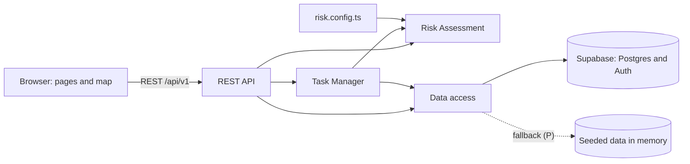
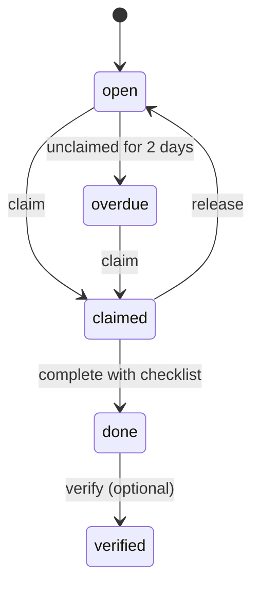

# Architecture

Draft, 21 Nov 2026. **(P)** marks a provisional default. Reasons are in [ADR.md](ADR.md).

## Stack

| Layer | Choice | Note |
|---|---|---|
| Web app | Next.js (App Router), TypeScript, Tailwind CSS | Pages and the REST API ship as one app |
| Map | Leaflet with OpenStreetMap tiles **(P)** | We draw the grid, assets and events ourselves. A tile-less mode covers offline |
| REST API | Next.js Route Handlers under `/api/v1` | The only thing that writes to the database |
| Modules | Plain TypeScript: Risk Assessment, Task Manager | Pure logic, unit-tested, no framework imports |
| Database | Supabase: Postgres, Auth, row-level security | |
| Hosting | Vercel for the app, Supabase cloud **(P)** | GitHub Pages cannot run an API. It keeps serving `legacy/` |
| Tests | Vitest on the two modules | |

## Modules



| Module | Does | Does not |
|---|---|---|
| Web app | Shows map, lists and forms. Calls the REST API | Compute risk. Write to Supabase |
| REST API | Checks who is calling and their role, validates input, calls the modules, returns JSON | Hold rules of its own |
| Risk Assessment | `assess(asset, state, now)` returns a score, a level and the factors that produced them. Reads thresholds from one config file | Touch the database or the network |
| Task Manager | Creates tasks from the three triggers, removes duplicates, moves tasks through their states, applies the effects of completion | Decide risk levels |
| Data access | One interface. Supabase first; in-memory is an **optional** second implementation, built only if time allows **(P)** | Contain logic |

## Roles

There is no steward and no paid crew. The community runs everything.

| Role | Sign-in | Can do |
|---|---|---|
| Resident | Not needed to report. Needed to claim and complete tasks | Report a problem at an asset by scanning its QR code. Claim a task, fix it, complete the checklist. Claim tasks marked `needs_skills` only if their profile says they have those skills |
| Admin (community coordinator) | Required | Register assets, see the dashboard, trigger simulated events, advance the demo clock, handle overdue tasks |

Anonymous complaints must be allowed by `auth.ts` and by the row-level security policies.

## Risk levels

One set of names everywhere: in code, the API, the database and the UI.

| Score | Level | Colour |
|---|---|---|
| 60 and over | Inspect first | Red |
| 40 to 59 | This week | Orange |
| Under 40 | Routine | Green |

## From trigger to completion

| Trigger | Starts when | Task Manager then |
|---|---|---|
| Due inspection | An asset's `next_inspection_due` has passed, found by `tick()` | Creates an inspection task, unless the asset already has one open |
| Complaint | A user posts a problem at an asset | Saves the complaint, creates a complaint task (or attaches it to one already open), asks Risk Assessment to rescore the asset |
| Hazardous event | Admin triggers rainfall or flooding on cells | Saves the event, rescores every asset in those cells, creates a hazard task for each asset the risk rules say needs a check |

After that every task follows the same path **(P)**:



- **Claim** is atomic: the update only succeeds while the task is still open, so two people cannot hold one task.
- **Complete** saves the checklist, resolves the linked complaint, sets the asset's last inspection to now, clears event checks, and rescores the asset. The response carries the risk level before and after.
- **Overdue:** a task nobody claims within 2 days becomes overdue, moves to the top of the task list, and alerts the Admin, who can ask a specific neighbour or fix it themselves.
- **Needs skills:** tasks on roofs, solar panels, cables or broken parts carry `needs_skills: true`. Only residents whose profile lists those skills can claim them; everyone else can still report.
- **Verify** is **optional**: done by a different resident from the one who completed it, or by an Admin **(P)**. The demo only needs open → claimed → done.
- **One open task per asset and trigger.** A second complaint or event is added to the open task as another reason. It does not create a duplicate.

## Time

Risk changes as days pass, and a demo lasts five minutes. So all code asks one function for the time: real time plus a demo offset that the Admin can advance **(P)**.

`tick()` does the work that depends on time: creates due inspections, rescores assets whose standing water has aged, creates a follow-up task when that pushes an asset to Inspect first, and marks tasks unclaimed for 2 days as overdue and alerts the Admin. It runs when the clock is advanced, when an event is created, and at most once a minute when the task list is read. No scheduler is needed.

## Folders

```
app/                 pages (sign in, map, tasks, assets, admin) and api/v1 route handlers
src/modules/risk/    assess(), the rain rule, risk.config.ts, tests
src/modules/tasks/   triggers, states, tick(), tests
src/server/repo/     the data interface, supabase.ts, memory.ts
src/server/auth.ts   who is calling and what role they have
supabase/            schema.sql, policies.sql, seed.ts (grid, assets, accounts, history)
legacy/              the first version: a static site on real Singapore open data
```

## If the network fails (P)

| Layer | Fallback |
|---|---|
| Supabase unreachable | Only if the optional in-memory backend was built: start the app with `DATA_BACKEND=memory`. Same API, seeded data held in the server's memory. Run it on the presenter's laptop and join phones to its hotspot |
| Map tiles unreachable | The map draws the grid and assets on a plain background. Tiles are decoration, never required |
| Everything fails | A recorded run-through, and the `legacy/` static site, which needs no network |

## Keys

The public Supabase key may reach the browser. The service key stays on the server, in environment variables, and is never committed. `.env*` is ignored by git.
