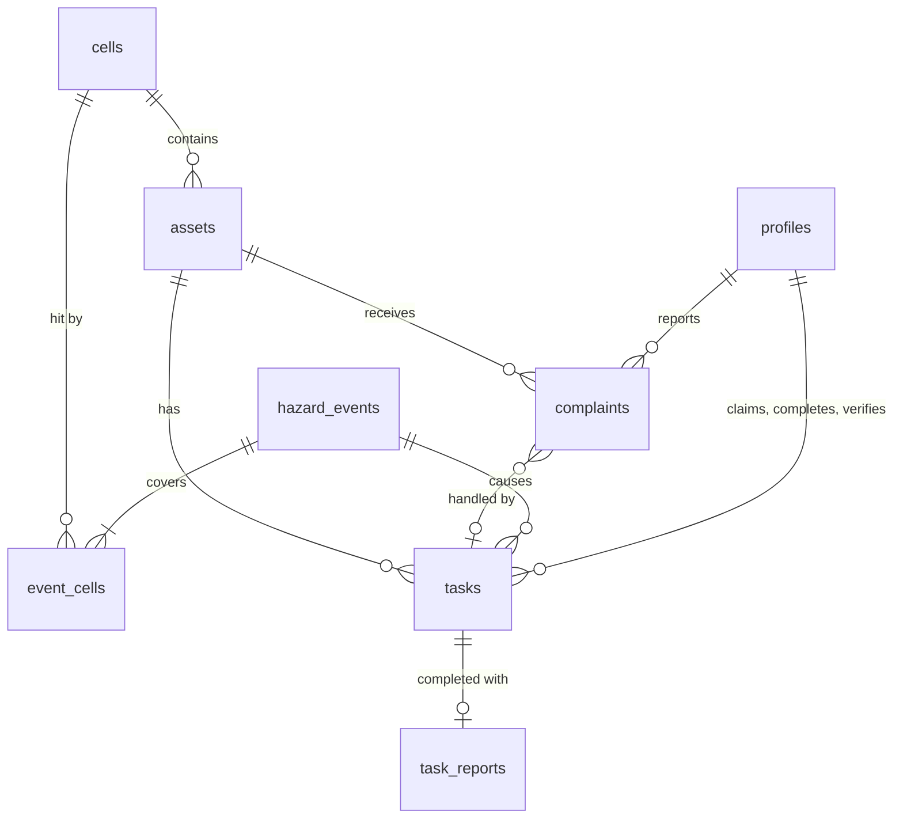

# Database

Supabase (Postgres and Auth). Draft, 21 Nov 2026. **(P)** marks a provisional default. All rows are simulated or fictional.

## Tables

| Table | Fields | Notes |
|---|---|---|
| `profiles` | `id` uuid PK (same as the Supabase Auth user), `display_name`, `role` ('user' or 'admin'), `active` bool, `created_at` | One row per account. Passwords stay in Supabase Auth |
| `cells` | `id` text PK (for example "C4"), `row`, `col`, `min_lng`, `min_lat`, `max_lng`, `max_lat` | The grid **(P)**. Seeded, 250 m squares |
| `assets` | `id` uuid PK, `code` unique (for example "G-07"), `type` ('garden', 'pond', 'solar'), `name`, `lat`, `lng`, `cell_id` → cells, `profile` text, `inspection_interval_days`, `last_inspected_at`, `next_inspection_due`, `risk_score` int, `risk_level` ('low', 'medium', 'high'), `risk_factors` jsonb, `risk_updated_at` | `profile` is the one assumed property per type: garden 'good_drainage' or 'poor_drainage', pond 'pump' or 'still', solar 'raised_meshed' or 'tray_low'. The `risk_*` fields are a cache written by the API |
| `hazard_events` | `id` uuid PK, `type` ('rain', 'flood'), `started_at`, `duration_hours`, `note`, `created_by` → profiles, `created_at` | Simulated, created from the Admin panel |
| `event_cells` | `event_id` → hazard_events, `cell_id` → cells, `intensity` numeric. PK is the pair | Rain: millimetres in the heaviest hour. Flood: depth in centimetres |
| `complaints` | `id` uuid PK, `asset_id` → assets, `reported_by` → profiles, `category` ('standing_water', 'pests', 'damage', 'blocked_drain', 'other'), `note` (300 characters at most), `status` ('open', 'resolved'), `task_id` → tasks, `created_at`, `resolved_at` | A problem a user reports at an asset |
| `tasks` | `id` uuid PK, `asset_id` → assets, `trigger` ('inspection', 'complaint', 'hazard'), `status` ('open', 'claimed', 'done', 'verified'), `priority` int, `reasons` jsonb, `event_id` → hazard_events, `created_at`, `due_at`, `claimed_by`, `claimed_at`, `done_by`, `done_at`, `verified_by`, `verified_at` | `priority` is the asset's risk score when the task was created or last updated. `reasons` lists what caused it. States are **(P)** |
| `task_reports` | `task_id` PK → tasks, `standing_water` bool, `pests` bool, `damage` bool, `actions` text[] (from: drained, emptied, cleared, covered, repaired, reported), `note`, `risk_before`, `risk_after`, `created_by`, `created_at` | The checklist filled in when a task is completed |
| `app_settings` | `key` text PK, `value` jsonb | `clock_offset_days` for the demo clock **(P)**, `last_tick_at` |

## Relationships

Two rules are enforced by the database itself:

- **One open task per asset and trigger:** a unique index on (`asset_id`, `trigger`) where `status` is 'open' or 'claimed'.
- **A task is claimed by one person:** the claim is `update ... where status = 'open'`, and it either changes one row or none.

## Who can read and write

| Table | User/Repairer | Admin |
|---|---|---|
| `profiles` | Read names and roles | Read all. Create, disable, change role |
| `cells` | Read | Read |
| `assets` | Read. Completing a task updates the inspection date and the risk fields | Read |
| `hazard_events`, `event_cells` | Read | Read. Create from the simulator |
| `complaints` | Read all. Create their own | Read all |
| `tasks` | Read all. Claim an open task. Release or complete a task they claimed. Verify a task someone else completed | The same, and may release or verify any task |
| `task_reports` | Read all. Create for a task they claimed | Read all |
| `app_settings` | Read | Read. Advance the clock, reset the demo data |

Nobody creates tasks directly. The Task Manager does, from the three triggers. Nobody creates or edits assets in the MVP.

## How it is enforced

- Row-level security is on for every table.
- A signed-in account may **select** from every table above. For `profiles` that is limited to `id`, `display_name`, `role` and `active`.
- No client may insert, update or delete. Every write goes through the REST API, which checks the caller's session and role and then writes with the service key **(Proposed, ADR 6)**.
- The service key exists only in the server's environment.

## Seed data

Written by `supabase/seed.ts`, the same generator that fills the in-memory fallback.

- A grid of 8 by 6 cells over a neighbourhood modelled on Singapore.
- About 36 assets, 12 of each type, with neutral names such as "Garden G-07". No real building, owner or address.
- Six accounts, five users and one Admin, with plainly fictional names and addresses ending `@greenparadox.example`.
- Three weeks of simulated history, so the first screen is not empty: past inspections, two rain events, a few completed tasks.
